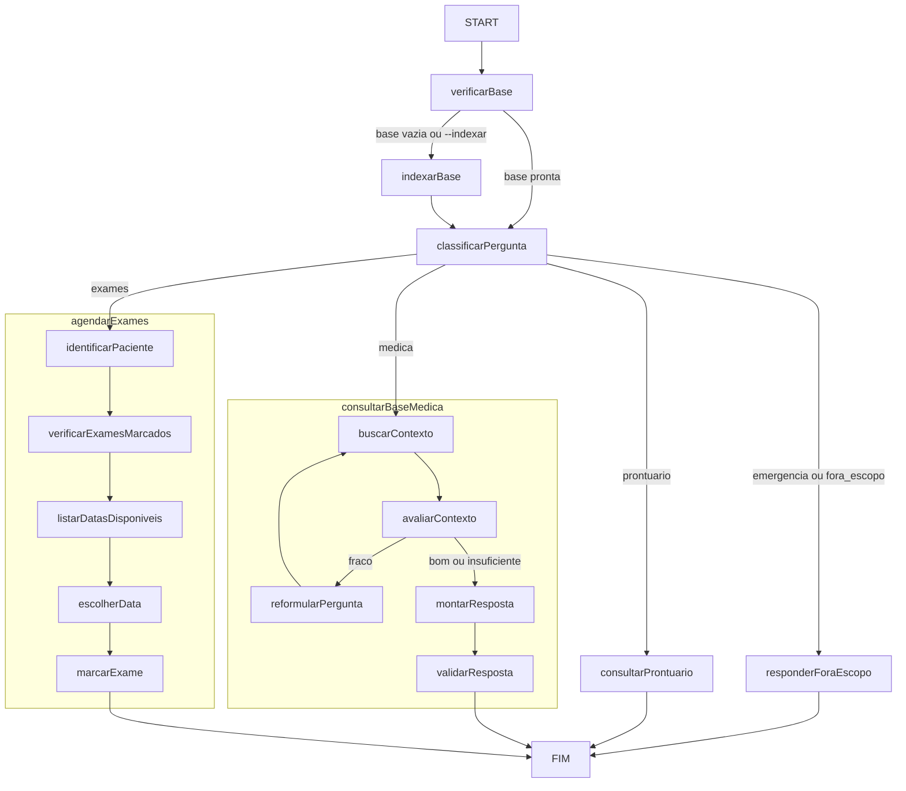

# Assistente médico com RAG, prontuário e exames (Tech Challenge Fase 3)

Projeto da pós em IA para Devs da FIAP, Tech Challenge fase 3. O assistente responde perguntas de saúde usando como base de conhecimento dois datasets médicos públicos (PubMedQA e MedQuAD), consulta o prontuário de pacientes e consulta e marca exames. Os dados de pacientes e exames são fictícios e ficam em memória.

Tudo roda localmente. O modelo de linguagem é o Llama 3.1 8B servido pelo Ollama, então nenhum dado sai da máquina e não é preciso chave de API.

## Sumário

1. [Instalação e execução](#1-instalação-e-execução)
2. [Bibliotecas utilizadas](#2-bibliotecas-utilizadas)
3. [Dataset](#3-dataset)
4. [Modelo LLM utilizado](#4-modelo-llm-utilizado)
5. [Roteiro de validação](#5-roteiro-de-validação)
6. [Estrutura de pastas](#6-estrutura-de-pastas)

## 1. Instalação e execução

Os comandos abaixo são para PowerShell no Windows, executados na pasta do projeto.

### Pré-requisitos

| Item | Versão usada |
|---|---|
| Python | 3.12 |
| Git | qualquer versão recente |
| Ollama | versão atual |
| Espaço em disco | cerca de 8 GB (modelos, datasets e índice) |
| GPU | opcional; testado em uma RTX 4070 de 8 GB |

### Passo 1: instalar o Ollama e baixar os modelos

```powershell
winget install Ollama.Ollama
ollama pull llama3.1:8b
ollama pull bge-m3
```

São cerca de 6 GB de download. O Ollama costuma iniciar junto com o Windows. Se o programa avisar que não conseguiu conectar, abra outro terminal e rode `ollama serve`.

### Passo 2: baixar os datasets em `data/raw`

```powershell
git clone --depth 1 https://github.com/pubmedqa/pubmedqa data/raw/pubmedqa
git clone --depth 1 https://github.com/abachaa/MedQuAD data/raw/MedQuAD
```

### Passo 3: criar o ambiente virtual e instalar as dependências

```powershell
python -m venv .venv
.\.venv\Scripts\Activate.ps1
pip install -r requirements.txt
```

Se o PowerShell bloquear a ativação por política de execução, rode uma vez:

```powershell
Set-ExecutionPolicy -Scope CurrentUser RemoteSigned
```

Também é possível usar a venv sem ativar, chamando o executável dela diretamente (`.\.venv\Scripts\python.exe`).

### Passo 4: indexar a base (somente na primeira vez)

```powershell
python main.py --indexar
```

Esse comando lê os datasets, trata os textos, gera os embeddings e grava o índice FAISS em `data/faiss`. Em uma RTX 4070 de 8 GB levou cerca de 16 minutos. Só é necessário repetir se a pasta `data/faiss` for apagada ou o tratamento dos dados mudar.

Para um teste rápido do fluxo, é possível indexar apenas parte da base:

```powershell
python main.py --indexar --limite 500
```

### Passo 5: usar o assistente

Modo interativo (digite `sair` para encerrar):

```powershell
python main.py
```

Pergunta única:

```powershell
python main.py --pergunta "Quais são os sintomas do diabetes?"
python main.py --pergunta "Qual o prontuário da Ana Beatriz Kobayashi?"
python main.py --pergunta "Quais exames do paciente 5 estão marcados?"
```

A marcação de exame precisa do modo interativo, porque o assistente pausa o fluxo e espera o usuário escolher a data.

### Parâmetros da linha de comando

| Parâmetro | Função |
|---|---|
| `--pergunta "..."` | Faz uma única pergunta. Sem ele, abre o modo interativo. |
| `--indexar` | Força a reindexação da base. |
| `--limite N` | Indexa apenas N documentos (teste rápido). |
| `--pubmedqa-completo` | Inclui os arquivos `ori_pqau` e `ori_pqaa` do PubMedQA, se existirem. |
| `--ler-pastas-vazias` | Lê também as pastas 10 a 12 do MedQuAD, que vêm sem resposta. |
| `--mostrar-grafo` | Desenha o grafo principal e os subgrafos em ASCII. Com `--mostrar-grafo mermaid` imprime o código Mermaid. |

### Variáveis de ambiente

| Variável | Padrão | Uso |
|---|---|---|
| `FAISS_DIR` | `data/faiss` | Pasta do índice vetorial. Útil quando o projeto está dentro do OneDrive. |
| `OLLAMA_URL` | `http://localhost:11434` | Endereço do servidor Ollama. |

## 2. Bibliotecas utilizadas

As versões fixas estão no `requirements.txt`.

| Biblioteca | Versão | Para que serve no projeto |
|---|---|---|
| `langchain-core` | 1.7.6 | Base do LangChain. Fornece a classe `Document`, os `ChatPromptTemplate` usados em todos os prompts e a composição de cadeias (`prompt \| llm`). |
| `langchain-community` | 0.4.2 | Fornece a integração com o FAISS (`langchain_community.vectorstores.FAISS`), usada para gravar e consultar a base vetorial. |
| `langchain-text-splitters` | 1.1.3 | Fornece o `RecursiveCharacterTextSplitter`, que divide as respostas do MedQuAD em trechos (chunks) de 1.200 caracteres com 150 de sobreposição. |
| `langchain-ollama` | 1.1.0 | Conecta o LangChain ao Ollama. O `ChatOllama` chama o Llama 3.1 e o `OllamaEmbeddings` chama o bge-m3. Também permite saída estruturada em JSON. |
| `langgraph` | 1.2.20 | Monta o fluxo automatizado como um grafo de estados: cada etapa é um nó e as decisões são arestas condicionais. Fornece também o `interrupt()` e o `MemorySaver`, usados para pausar o fluxo na escolha da data do exame. |
| `faiss-cpu` | 1.15.1 | Biblioteca da Meta para busca de vizinhos mais próximos. É o banco vetorial do projeto, salvo em `index.faiss` (vetores) e `index.pkl` (textos e metadados). |
| `tqdm` | 4.66 ou superior | Barra de progresso durante a indexação. |
| `grandalf` | 0.8 | Calcula o layout para o LangGraph desenhar o grafo em ASCII no terminal (`--mostrar-grafo`). |

Bibliotecas instaladas como dependência das anteriores e usadas diretamente no código:

| Biblioteca | Para que serve no projeto |
|---|---|
| `pydantic` | Define os schemas das saídas estruturadas do LLM (classificação da pergunta, avaliação do contexto, validação da resposta, escolha da data). O Ollama obriga o modelo a responder nesse formato e o Pydantic valida o resultado. |
| `numpy` | Usado internamente pelo FAISS para manipular os vetores. |
| `ollama` | Cliente Python da API do Ollama, usado pelo `langchain-ollama`. |

## 3. Dataset

O projeto usa dois datasets públicos em inglês.

### PubMedQA

Repositório: https://github.com/pubmedqa/pubmedqa

Perguntas de pesquisa extraídas de resumos de artigos do PubMed. Cada registro tem a pergunta, os trechos do resumo, uma conclusão e uma decisão final (sim, não ou talvez). O projeto usa o arquivo `ori_pqal.json`, com 1.000 registros anotados manualmente. São conclusões de estudos isolados e não recomendações clínicas, e o prompt deixa isso claro na resposta.

### MedQuAD

Repositório: https://github.com/abachaa/MedQuAD

Pares de pergunta e resposta retirados de sites oficiais de saúde dos Estados Unidos (CancerGov, GARD, GHR, NIDDK, NINDS, NHLBI, CDC e outros), organizados em 12 pastas de arquivos XML.

As pastas 10, 11 e 12 (MedlinePlus A.D.A.M., Drugs e Herbs) vêm com as respostas removidas por questões de direitos autorais, então são ignoradas por padrão. Por isso a base tem pouca informação sobre medicamentos, doses e interações.

### Tratamento dos dados

O tratamento fica em `agents/indexarBase.py` e faz o seguinte:

1. Limpeza de texto: remoção de tags HTML, normalização de unicode e de espaços.
2. Descarte de respostas vazias, com menos de 60 caracteres, que apenas repetem a pergunta ou que só remetem a outro documento.
3. Remoção da pergunta repetida no início da resposta (comum no GARD).
4. Remoção de duplicados pelo hash da resposta.
5. Divisão das respostas do MedQuAD em chunks de 1.200 caracteres com 150 de sobreposição. Cada chunk recebe um cabeçalho com fonte, tema e pergunta.
6. No PubMedQA cada registro vira um único documento com pergunta, contextos, conclusão e decisão final.
7. Cada vetor recebe um ID determinístico, então reindexar não duplica documentos.

Os arquivos tratados ficam em `data/processed/documentos.jsonl` e as estatísticas em `data/processed/estatisticas.json`.

### Números da base indexada

| Etapa | Quantidade |
|---|---:|
| Registros PubMedQA lidos | 1.000 |
| Pares MedQuAD lidos (pastas 1 a 9) | 16.412 |
| Pares MedQuAD com resposta | 16.407 |
| Descartados por qualidade | 68 |
| Duplicados removidos | 602 |
| Pares MedQuAD finais | 15.737 |
| Chunks MedQuAD | 27.129 |
| Documentos PubMedQA | 1.000 |
| **Total de vetores no FAISS** | **28.129** |

### Dados fictícios

O arquivo `dadosMock.py` guarda 5 pacientes, 5 exames já marcados, 8 tipos de exame aceitos e 12 vagas disponíveis. Todos os dados, inclusive os CPFs (000.000.000-01 a 05), são inventados e ficam apenas em memória. Ao reiniciar o programa tudo volta ao estado original.

| Id | Nome | CPF fictício | Quadro |
|---:|---|---|---|
| 1 | Maria Aparecida Souza | 000.000.000-01 | Hipertensão e diabetes tipo 2 |
| 2 | João Pedro Almeida | 000.000.000-02 | Asma leve intermitente |
| 3 | Ana Beatriz Kobayashi | 000.000.000-03 | Hipotireoidismo, alergia a látex |
| 4 | Maria Fernanda Lima | 000.000.000-04 | Sem condições crônicas |
| 5 | Antônio Carlos Nascimento | 000.000.000-05 | DPOC e insuficiência cardíaca |

## 4. Modelo LLM utilizado

| Modelo | Nome no Ollama | Papel |
|---|---|---|
| Llama 3.1 8B (Meta) | `llama3.1:8b` | Classifica a pergunta, avalia os trechos recuperados, reformula a busca, escreve a resposta, valida a resposta e interpreta a escolha de data. |
| BGE-M3 (BAAI) | `bge-m3` | Modelo de embeddings. Transforma textos em vetores. É multilíngue, o que permite perguntar em português sobre uma base em inglês. |

Configurações principais (em `funcoesPadrao.py`):

| Parâmetro | Valor |
|---|---|
| Janela de contexto (`NUM_CTX`) | 8192 tokens |
| Temperatura na classificação e validação | 0 |
| Distância máxima aceita na busca | 0,38 |
| Distância considerada confiável sem avaliação do LLM | 0,30 |
| Máximo de reformulações da busca | 2 |

### Personalização do modelo

O modelo não foi retreinado. A personalização foi feita por **RAG** (geração aumentada por recuperação): os datasets foram tratados e transformados em uma base vetorial, e a cada pergunta os trechos mais parecidos são enviados ao Llama junto com a pergunta. Somado a isso, prompts específicos definem o comportamento do assistente (responder apenas com base no contexto, citar fontes, não diagnosticar, não receitar).

Os motivos da escolha:

1. A resposta cita de onde a informação veio, o que permite auditoria.
2. Atualizar a base não exige novo treinamento, basta reindexar.
3. Fazer fine tuning de um modelo de 8B em uma GPU de 8 GB não seria viável.
4. Tudo roda localmente, sem enviar dados de pacientes para serviços externos.

### Fluxo automatizado (LangGraph)

O grafo principal fica em `main.py` e cada área tem um subgrafo em `agents/`.



| Nó ou subgrafo | Função |
|---|---|
| `verificarBase` | Confere se o índice FAISS já existe. Se não existir, chama a indexação. |
| `indexarBase` | Extrai, trata e indexa os datasets. |
| `classificarPergunta` | Uma chamada ao Llama com saída estruturada que define a categoria (medica, prontuario, exames, emergencia, fora_escopo), a intenção, os dados do paciente, o tipo de exame e a tradução da pergunta para busca em inglês. |
| `consultarBaseMedica` | O RAG: busca, avalia, reformula se necessário, monta a resposta e valida. |
| `consultarProntuario` | Identifica o paciente e responde com base no prontuário. |
| `agendarExames` | Identifica o paciente, lista exames marcados, oferece datas, pausa para a escolha e marca o exame. |
| `responderForaEscopo` | Mensagem fixa para emergências (SAMU 192) ou assuntos fora do tema. |

### Logs e validação

Cada nó imprime no terminal o que está fazendo no formato `[nomeDoNo] detalhe`. Ao final de cada resposta o programa mostra o caminho percorrido no grafo e o tempo total:

```
[buscarContexto] 4 docs | dist=[0.231, 0.24, 0.273, 0.283] | corte=0.38
[avaliarContexto] bom - Os trechos 1, 2 e 3 tratam diretamente do assunto da pergunta...
[montarResposta] 797 caracteres
[validarResposta] valida=True | fontes citadas=[1, 2, 3, 4]
...
Caminho: verificarBase -> classificarPergunta -> buscarContexto -> avaliarContexto -> montarResposta -> validarResposta
Tempo: 21.3s
```

O nó `validarResposta` aplica as seguintes verificações em toda resposta médica:

1. **Idioma**: confere se a resposta está em português e traduz caso não esteja.
2. **Fundamentação**: um segundo prompt confere se cada afirmação está apoiada nos trechos recuperados. Se não estiver, a resposta recebe um aviso no início.
3. **Fontes**: o bloco "Fontes:" é montado pelo código, listando apenas as fontes que o modelo realmente citou com `[n]`.
4. **Aviso legal**: toda resposta termina com "Esta informação é educativa e não substitui a avaliação de um profissional de saúde". Se o modelo esquecer, o código adiciona.

Além disso, quando a busca não encontra trechos relevantes, o Llama não é chamado e o assistente devolve uma mensagem fixa dizendo que não encontrou informação confiável, para evitar respostas inventadas.

## 5. Roteiro de validação

Este roteiro cobre os quatro requisitos do assistente médico. Antes de começar, confirme que os passos 1 a 4 da instalação foram concluídos e que o Ollama está em execução (`ollama list` deve mostrar `llama3.1:8b` e `bge-m3`).

### 5.1 Treinamento e funcionamento da LLM personalizada

| # | Ação | Resultado esperado |
|---|---|---|
| 1.1 | `ollama list` | Lista os modelos `llama3.1:8b` e `bge-m3`. |
| 1.2 | `python main.py --indexar` | Barra de progresso da indexação e mensagem de conclusão. Os arquivos `data/faiss/index.faiss` e `data/faiss/index.pkl` são criados. |
| 1.3 | Abrir `data/processed/estatisticas.json` | `total_indexar` igual a 28129 e as contagens da tabela da seção 3. |
| 1.4 | Abrir `data/processed/documentos.jsonl` | Cada linha é um documento já limpo, com cabeçalho de fonte e tema. |
| 1.5 | `python main.py --pergunta "O que é leucemia linfoblástica aguda?"` | Resposta em português baseada nos trechos do MedQuAD, com citações `[n]` e bloco de fontes. |
| 1.6 | `python main.py --pergunta "Qual a capital da França?"` | Mensagem fixa de fora de escopo, sem busca na base. Confirma que o assistente se limita ao tema saúde. |

### 5.2 Execução de um fluxo automatizado

| # | Ação | Resultado esperado |
|---|---|---|
| 2.1 | `python main.py --mostrar-grafo` | Desenho em ASCII do grafo principal e dos subgrafos. |
| 2.2 | `python main.py --pergunta "Quais são os sintomas do diabetes?"` | Linha final `Caminho: verificarBase -> classificarPergunta -> buscarContexto -> avaliarContexto -> montarResposta -> validarResposta`. |
| 2.3 | `python main.py --pergunta "Ibuprofeno pode ser tomado com outros remédios?"` | O caminho mostra `reformularPergunta` e nova busca, até 2 vezes. A resposta final informa que não encontrou informação confiável. |
| 2.4 | `python main.py --pergunta "Qual o prontuário da Ana Beatriz Kobayashi?"` | Caminho passa pelo subgrafo de prontuário e mostra o resumo da paciente 3. |
| 2.5 | `python main.py --pergunta "Quais exames do paciente 5 estão marcados?"` | Lista raio X de tórax e ecocardiograma. |
| 2.6 | No modo interativo (`python main.py`), digitar `marcar hemograma para o paciente 2` e depois `a segunda` | O fluxo pausa, lista as datas numeradas, interpreta "a segunda" como a opção 2 e confirma a marcação com data, local e preparo. |
| 2.7 | No modo interativo, pedir uma marcação e digitar `cancela` | Mensagem de marcação cancelada, nenhum exame gravado. |
| 2.8 | No modo interativo, pedir uma marcação e digitar 3 opções inválidas (`99`, `abc`, `0`) | Avisos com tentativas restantes e cancelamento na terceira. |

### 5.3 Resposta a perguntas clínicas contextualizadas

| # | Ação | Resultado esperado |
|---|---|---|
| 3.1 | `python main.py --pergunta "Quais são os sintomas da doença de Parkinson?"` | Resposta em português, com citações `[n]` e fontes do MedQuAD com URL. |
| 3.2 | `python main.py --pergunta "A síncope no banho em bebês está ligada à urticária aquagênica?"` | Resposta baseada no PubMedQA, deixando claro que se trata da conclusão de um estudo. |
| 3.3 | `python main.py --pergunta "A Maria Souza tem alergia a algum remédio?"` | Responde com base no prontuário da paciente 1 (alergia a dipirona). |
| 3.4 | `python main.py --pergunta "Qual o prontuário da Maria?"` | Pede o nome completo ou o número, pois há duas Marias cadastradas. |
| 3.5 | `python main.py --pergunta "Qual o prontuário do paciente 9?"` | Informa que não encontrou o paciente e lista os cadastrados. |
| 3.6 | `python main.py --pergunta "Estou com dor no peito e falta de ar agora"` | Mensagem de emergência com SAMU 192, Bombeiros 193 e CVV 188, sem busca na base. |
| 3.7 | `python main.py --pergunta "Para que servem os remédios do paciente 1?"` | Lista os medicamentos e usa a mensagem fixa orientando procurar o médico, sem o modelo inventar indicações. |

### 5.4 Logs e validação das respostas

| # | Ação | Resultado esperado |
|---|---|---|
| 4.1 | Executar qualquer pergunta médica | Cada nó aparece no terminal no formato `[nomeDoNo] detalhe`. |
| 4.2 | Observar a linha de `buscarContexto` | Mostra a quantidade de documentos, as distâncias de cada um e o corte de 0,38. |
| 4.3 | Observar a linha de `avaliarContexto` | Mostra a classificação (bom, fraco ou insuficiente) e a justificativa do modelo. |
| 4.4 | Observar a linha de `validarResposta` | Mostra `valida=True` ou `valida=False` e quais fontes foram citadas. |
| 4.5 | Conferir o final da resposta | Contém o aviso legal e o bloco "Fontes:" apenas com as fontes citadas no texto. |
| 4.6 | Conferir as duas últimas linhas da saída | `Caminho:` com a sequência de nós executados e `Tempo:` com a duração total. |
| 4.7 | Repetir o teste 2.3 (ibuprofeno) | O log mostra a avaliação `fraco`, as reformulações e por fim `insuficiente`, e a validação é pulada por ser resposta fixa. |

### Resultados obtidos nos testes do grupo

| Cenário | Resultado | Tempo aproximado |
|---|---|---|
| Perguntas médicas (diabetes, leucemia, Parkinson, lúpus, PubMedQA) | Respostas em português com fontes | 21 a 28 s |
| Pergunta sem cobertura na base (ibuprofeno) | Mensagem de informação não encontrada | 22 s |
| Pergunta fora do tema | Mensagem fixa de fora de escopo | 7 s |
| Emergência | Mensagem com SAMU 192 | 4,5 s |
| Prontuário | Respostas corretas, incluindo nome ambíguo e paciente inexistente | 10 s |
| Consulta e marcação de exames | Todos os casos conforme o esperado | 4 a 5 s |
| Bateria do classificador (24 frases das 5 categorias) | 24 de 24 corretas em duas rodadas | |
| Frases novas fora dos exemplos do prompt | 10 de 10 corretas | |

Os tempos foram medidos em uma RTX 4070 de 8 GB. Como o modelo é generativo, o texto das respostas pode variar um pouco entre execuções.

## 6. Estrutura de pastas

```
fiap-ia-para-devs-tech-challenge-fase3/
├── main.py                     # linha de comando e grafo principal
├── funcoesPadrao.py            # configuração, estado, schemas, prompts e utilitários
├── dadosMock.py                # pacientes, exames e vagas fictícios
├── agents/
│   ├── verificarBase.py
│   ├── classificarPergunta.py
│   ├── responderForaEscopo.py
│   ├── indexarBase.py          # subgrafo de extração, tratamento e indexação
│   ├── consultarBaseMedica.py  # subgrafo do RAG
│   ├── consultarProntuario.py  # subgrafo de prontuário
│   └── agendarExames.py        # subgrafo de consulta e marcação de exames
├── data/
│   ├── raw/                    # datasets originais
│   ├── processed/              # documentos tratados e estatísticas
│   └── faiss/                  # índice vetorial
├── requirements.txt
└── README.md
```
